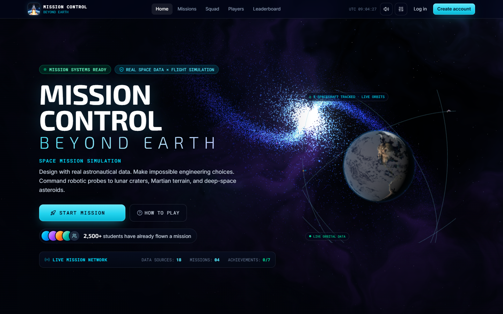
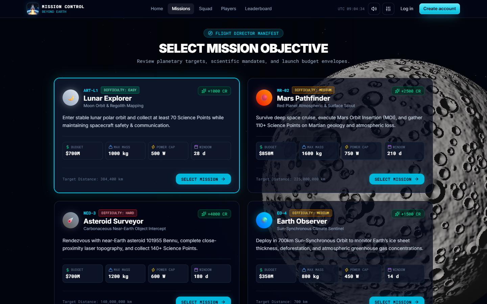
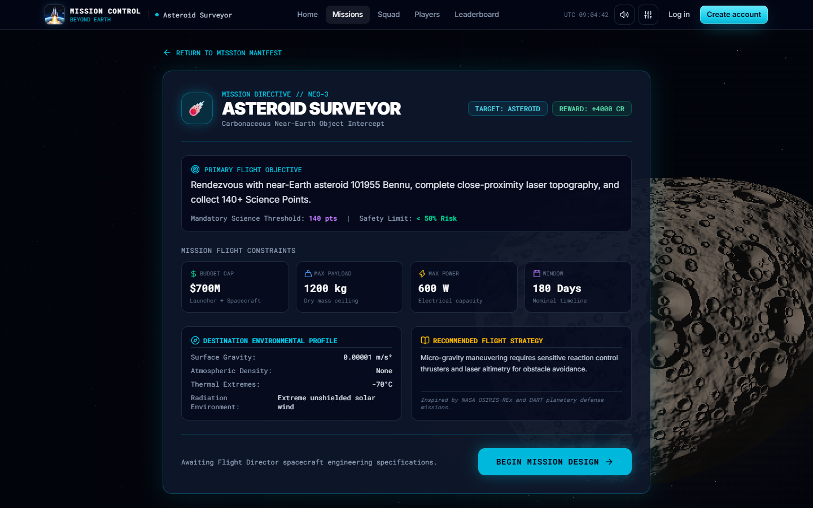
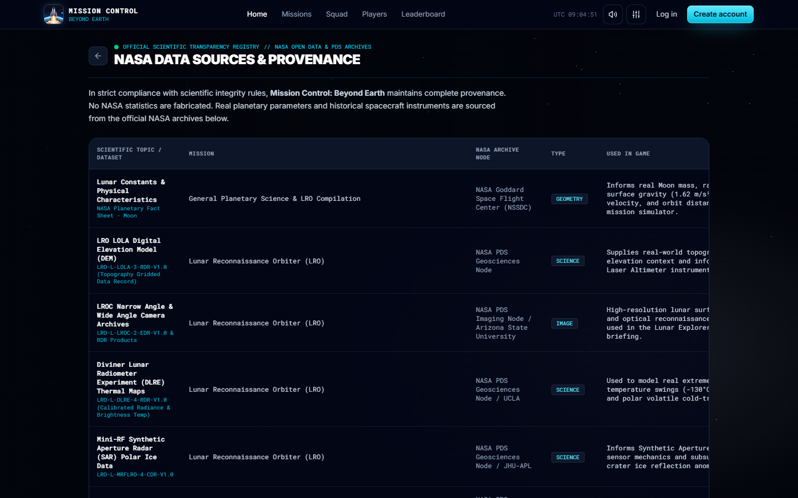
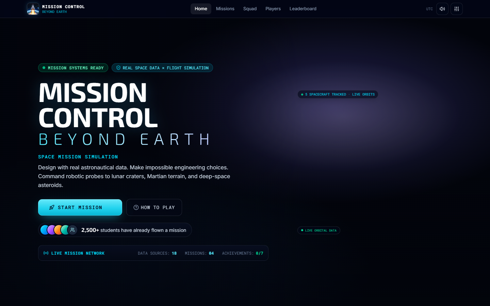
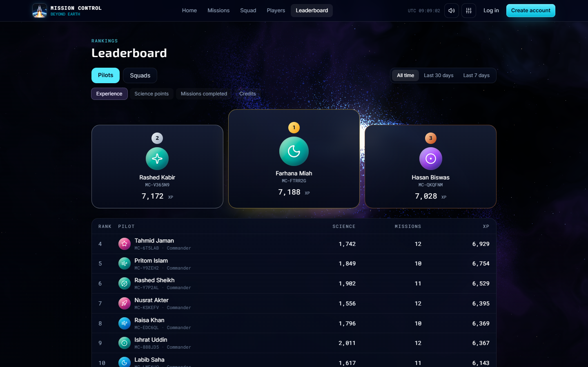
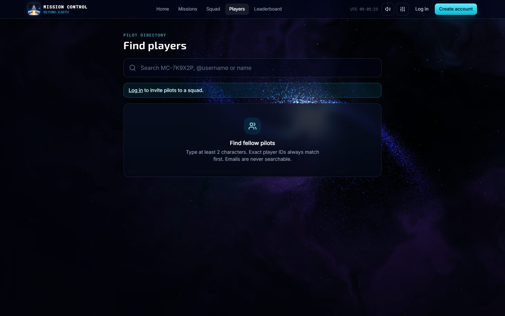
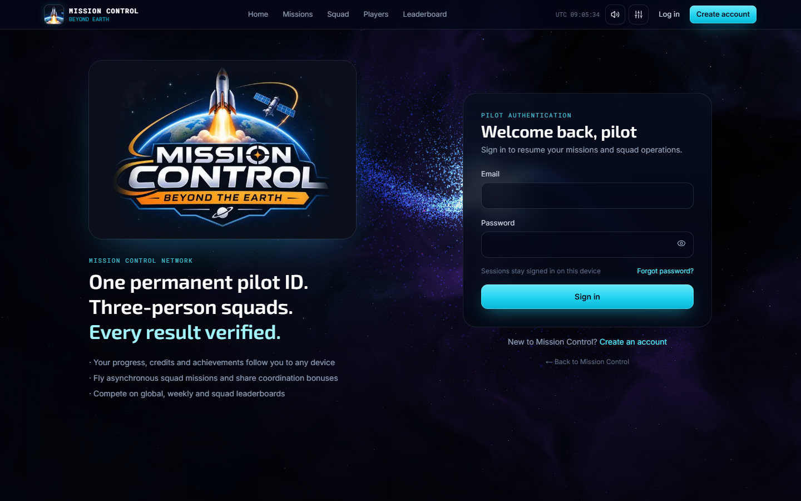

<div align="center">


# Mission Control: Beyond Earth

**Plan a real space mission, build the spacecraft, fly the launch, and bring the science home: alone or with a crew of up to four.**

A browser-based space mission strategy and simulation game built on real NASA data and live NASA feeds.
Made for the **NASA International Space Apps Challenge**.

[](https://youtu.be/RUyyqqw2kq0?si=id1uJnqU7WgkstfD)
[](https://beyond-earth-xi.vercel.app)


[বাংলায় পড়ুন (Bangla guide)](README_BN.md) · [Multiplayer & database guide](docs/multiplayer.md)

</div>

---

## Table of contents

1. [Presentation video](#-presentation-video)
2. [Screenshots](#-screenshots)
3. [What is it?](#-what-is-it)
4. [How to play: solo](#-how-to-play-solo-pilot)
5. [How to play: squad (team)](#-how-to-play-squad-team-mission)
6. [Scores, rewards and leaderboards](#-scores-rewards-and-leaderboards)
7. [NASA and open data we use](#-nasa-and-open-data-we-use)
8. [Accessibility](#-accessibility)
9. [Tech stack](#-tech-stack)
10. [Run it locally](#-run-it-locally)
11. [Project structure](#-project-structure)
12. [Declaration and agreements](#-declaration-and-agreements)

---

## 🎬 Presentation video

[](https://youtu.be/RUyyqqw2kq0?si=id1uJnqU7WgkstfD)

▶ **https://youtu.be/RUyyqqw2kq0**

---

## 📸 Screenshots

| Title screen | Mission select |
|:---:|:---:|
|  |  |
| **Mission briefing (Asteroid Surveyor → Bennu)** | **NASA data sources & provenance** |
|  |  |
| **NASA data explorer** | **Leaderboard** |
|  |  |
| **Players: find crew mates** | **Pilot sign-in** |
|  |  |

---

## 🌍 What is it?

You are the Mission Director. Pick one of four real-world-inspired missions, stay inside the budget, mass and power limits, choose a rocket and a trajectory, check the launch weather, and then fly it. During the flight, problems come up (solar storms, lost signal, power faults, micrometeoroids) and you decide how to respond. At the end, a debrief scores your science, safety, budget and efficiency, and explains which decisions helped or hurt.

| # | Mission | Target | Difficulty | Budget | Max mass | Duration |
|:-:|---|---|:-:|:-:|:-:|:-:|
| 01 | 🌙 **Lunar Explorer** | Moon (South Pole–Aitken basin, water ice) | Easy | $500M | 1000 kg | 28 days |
| 02 | 🔴 **Mars Pathfinder** | Mars (orbit insertion, atmospheric spectroscopy) | Medium | $850M | 1600 kg | 210 days |
| 03 | ☄️ **Asteroid Surveyor** | Near-Earth asteroid **101955 Bennu** | Hard | $700M | 1200 kg | 180 days |
| 04 | 🌍 **Earth Observer** | Sun-synchronous Earth orbit (climate) | Medium | $350M | 800 kg | 14 days |

---

## 🧑‍🚀 How to play: solo pilot

> Anyone can browse missions, briefings and the NASA data pages. **Starting a mission needs a free account**, because results, credits and rankings are verified and stored on the server.

1. **Create an account** (email or Google) → you get a Player ID (e.g. `MC-BCBCPV`) and 1,000 starting credits.
2. **Choose a mission** on the mission select screen.
3. **Read the briefing.** It shows the target's gravity, atmosphere, temperature and radiation, your budget, mass and power caps, the science target and the safety limit.
4. **Build the spacecraft.** Choose parts from 7 subsystems: structure, instruments, power, communication, propulsion, thermal and navigation. The blueprint updates live. Warnings such as `SPACECRAFT TOO HEAVY`, `POWER DEFICIT` or `BUDGET EXCEEDED` must be cleared. Matching instruments unlock **synergy bonuses** (for example, camera + laser altimeter gives 3D topographic mapping).
5. **Pick a launcher and trajectory.** Small / Medium / Heavy rockets have payload limits. A Hohmann transfer saves fuel, a fast transfer saves time but is riskier.
6. **Check launch weather (GO / NO-GO).** Live pad weather, NASA space weather and (for Bennu) today's near-Earth asteroids are shown. Launching into NO-GO weather can destroy the rocket.
7. **Launch.** A cinematic 3D countdown and ascent with several camera modes, staging events, Max-Q and orbit insertion.
8. **Mission Control.** Watch the live telemetry (distance, velocity, fuel, power, signal, risk, science), change the simulation speed, and **answer in-flight emergencies** with trade-off choices.
9. **Debrief.** You get a score from 0–100 and a rank (Mission Legend, Specialist, Survivor or Learning Experience), plus a timeline of your key decisions. Credits, XP and science points are added to your profile.

**Keyboard and sound:** every screen can be used with a mouse, touch or keyboard. Procedural sound effects and voice call-outs ("T minus ten…") can be muted or adjusted in Settings.

---

## 👩‍🚀👨‍🚀 How to play: squad (team mission)

Squads are teams of **2 to 4 pilots** who fly **one shared mission together in real time**. Every member sees the same screen, and each decision belongs to a crew role.

### 1. Form a squad
- Open **Squad** → *Create squad* (you become the leader), or accept an invitation from the notification bell.
- Go to **Players**, search by name or Player ID, and press **Invite**. When you invite someone, you choose the role they will join with.
- A squad needs at least **2 members** to start a mission. It can hold up to 4.

### 2. Plan the crew (20 roles in 4 groups)
| Group | Roles |
|---|---|
| **Command** | Mission Commander · Mission Director · Mission Planner · Project Manager · Risk Manager |
| **Engineering** | Aerospace · Mechanical · Electrical · Software · Thermal Engineer |
| **Science** | Science Officer · Planetary Scientist · Research Scientist · Data Scientist · Robotics Engineer |
| **Operations** | Flight Director · Flight Controller & Astronaut · Navigation Officer · Propulsion Engineer · Communication Officer |

- The leader uses the **Crew planner** to give each role to one member. A member can hold several roles, and *Auto-assign* fills the plan for you.
- Each role has an **(i)** button that explains its duties. The planner shows a **team score** and the **cohesion bonus** it gives in the simulation.
- Any role that nobody holds is covered by the leader.

### 3. Fly the mission together
The squad mission room (`/squad/<squad>/<mission>`) moves everyone through the same six stages:

**Briefing → Builder → Launcher & trajectory → Launch → Mission control → Debrief**

- **Every action is role-checked by the database.** For example, the **Mission Director** sets the budget, engineers choose their subsystem parts, the **Risk Manager** can sign a weather waiver, the **Flight Director** declares GO, and the **Flight Controller** presses LAUNCH. If you try another role's job, you see *"Not your job — that needs: …"*.
- The squad HUD at the top shows the stage, your roles, your duties for this stage, and the budget.
- In-flight emergencies are answered by the role responsible for them.
- The **squad chat** (bubble at the bottom-right of every page) keeps the crew talking. Messages are stored and visible only to the squad.

### 4. Rewards for the team
- At the debrief, every member claims their reward from the **same server-stored result**.
- When 2 or more members succeed on a squad mission, each of them gets a **+10% coordination credit bonus**.
- **Squad totals** (science points, mission XP, squad credits, missions completed) grow from **every mission a member flies**, solo or squad, while they are in the squad. They decide the squad's place on the **Squads leaderboard**.

---

## 🏆 Scores, rewards and leaderboards

All rewards are calculated **on the server** (Postgres functions). Values sent by the browser are clamped to what is physically possible, so scores cannot be forged.

| Item | Rule |
|---|---|
| **Status** | SUCCESS needs science ≥ the mission target and risk < 70%. Otherwise it is downgraded to PARTIAL. |
| **Score (0–100)** | 45% science + 35% safety + 20% fuel efficiency (a FAILURE is capped at 45) |
| **Credits** | SUCCESS = full mission reward, PARTIAL = 50%, FAILURE = 0 |
| **XP** | mission base XP × (1 / 0.5 / 0.2) + score |
| **Squad bonus** | +10% credits once 2+ squad members succeed on the same squad mission |
| **Anti-cheat** | minimum flight time per mission, one reward per run, science capped per mission |

The leaderboards rank **pilots** and **squads** by experience, science points, missions completed or credits, for all time, the last 30 days or the last 7 days.

---

## 🛰️ NASA and open data we use

### Live feeds (fetched by our server routes; API keys never reach the browser)

| Source | Endpoint | How it is used in the game |
|---|---|---|
| **NASA DONKI** (solar flares, CMEs, geomagnetic storms) | `https://api.nasa.gov/DONKI/FLR` (also `/DONKI/CME` and `/DONKI/GST`), with NASA CCMC's DONKI service as a fallback | The last 7 days of flares, CMEs and storms set the space-weather level (quiet / active / storm). This **adds 0, +3 or +6 risk points to every mission's flight** (half for Earth orbit, which is inside the magnetosphere). Route: [`/api/nasa/space-weather`](src/app/api/nasa/space-weather/route.ts) |
| **NASA NeoWs** (Near Earth Object Web Service) | `https://api.nasa.gov/neo/rest/v1/feed` | Today's near-Earth asteroids: each potentially hazardous object **adds +1 risk point (max +3) to the Bennu asteroid mission**, and the closest approach is shown in the launch panel. Route: [`/api/nasa/neo`](src/app/api/nasa/neo/route.ts) |
| **NASA POWER** | `https://power.larc.nasa.gov/api/temporal/hourly/point` | Hourly NASA meteorology (temperature, wind, rain, humidity) at the launch pad. Route: [`/api/nasa/weather`](src/app/api/nasa/weather/route.ts) |
| **Open-Meteo** | `https://api.open-meteo.com` | Real-time wind, rain, cloud and thunderstorm nowcast for the launch **GO / NO-GO** decision |

### Reference datasets (built into the simulation, with full provenance in the in-game *Data Sources* page)

- **NASA NSSDC Planetary Fact Sheets**: gravity, radius, escape velocity and orbits of the Moon, Mars and Earth
- **LRO** (LOLA elevation, LROC imagery, Diviner thermal maps, Mini-RF radar ice data, CRaTER radiation) from the **NASA PDS** Geosciences, Imaging and PPI nodes
- **LRO WAC global lunar mosaic**, **MGS MOLA and MRO MARCI Mars** topography and colour (NASA PDS)
- **NASA Blue Marble** Earth textures and a NASA/NOAA-derived cloud layer
- **NASA JPL Deep Space Network** link behaviour for the communications model
- **OSIRIS-REx / Bennu** mission parameters for the asteroid mission
- **CelesTrak / NORAD TLE**, **Landsat-9**, **Sentinel-2** and **NOAA-20 (JPSS)** orbital elements for Earth orbit

A full list of datasets, archives, retrieval dates and links is in the game (**Title → Data Sources**) and in [`provenanceCatalog.ts`](src/data/nasa/metadata/provenanceCatalog.ts). No NASA numbers are made up.

> **NASA API key:** without `NASA_API_KEY` the app uses NASA's shared `DEMO_KEY`, which is limited to about 30 requests per hour per IP address. When that limit is hit, the NeoWs feed shows as unavailable and adds no risk. For a deployment, get a free key at <https://api.nasa.gov> and set `NASA_API_KEY`.

---

## ♿ Accessibility

- Every interactive control has a text label or `aria-label`. Live regions announce chat, launch status and alerts.
- The whole game can be played with a mouse, touch or keyboard, and the layout works from phone width up to desktop.
- **Sound and image together:** important events are shown on screen *and* played as sound or spoken voice call-outs. Sound can be muted, and visuals never rely on sound alone.
- A **Reduced motion** setting turns off heavy animation (starfield, explosions, weather effects).
- High-contrast text on solid panels over the animated space background.

---

## 🛠️ Tech stack

| Layer | Technology |
|---|---|
| Framework | **Next.js 16** (App Router, Server Actions, Turbopack), **React 19**, **TypeScript** |
| Styling & motion | Tailwind CSS 4, Framer Motion |
| 3D & graphics | Three.js, React Three Fiber / Drei (3D launch), HTML5 Canvas (blueprint, orbit map, starfield) |
| State | Zustand |
| Audio | Web Audio API procedural synthesizer + speech synthesis call-outs |
| Backend | **Supabase**: Postgres with Row Level Security, security-definer RPCs, Realtime (squad rooms, chat, notifications), Auth (email + Google) |
| Validation | Zod (server actions) |
| Tests | PGlite (in-process Postgres) database test suite, plus unit tests |

---

## 💻 Run it locally

**Requirements:** Node.js 20+ (22 recommended) and a free Supabase project. The single-player game also runs without Supabase.

```bash
git clone https://github.com/kazinayeem/Beyond-Earth.git
cd Beyond-Earth
npm install
cp .env.local.example .env.local     # then fill in the values below
npm run dev                          # http://localhost:3000
```

**`.env.local`**

| Variable | Needed for |
|---|---|
| `NEXT_PUBLIC_SUPABASE_URL` | accounts, squads, leaderboards |
| `NEXT_PUBLIC_SUPABASE_PUBLISHABLE_KEY` | accounts, squads, leaderboards |
| `NASA_API_KEY` | reliable live NASA feeds (otherwise the rate-limited `DEMO_KEY` is used) |
| `SUPABASE_DB_PASSWORD` | `npm run db:migrate` (applies the database migrations) |
| `SUPABASE_DB_POOLER_HOST` | *optional*: the session pooler host (e.g. `aws-0-ap-southeast-1.pooler.supabase.com`) for IPv4-only networks |

**Database**

```bash
npm run db:migrate            # apply supabase/migrations to your project
npm run test:db               # run the database test suite on a local in-memory Postgres
npm run verify:supabase       # check the live project
```

In the Supabase dashboard, enable **Realtime** for `squad_games`, `squad_messages` and `player_notifications`. See [docs/multiplayer.md](docs/multiplayer.md) for the full guide.

| Script | What it does |
|---|---|
| `npm run dev` / `build` / `start` | develop, build and serve the app |
| `npm run lint` | ESLint |
| `npm test` | unit and database tests |
| `npm run seed:demo` | optional demo pilots and squads |

---

## 🗂️ Project structure

```
src/
  app/
    page.tsx                      # solo game (GameShell)
    (squadgame)/squad/[squadId]/[missionId]/   # real-time squad mission room
    (network)/                    # squad, players, leaderboard, profile, notifications
    api/nasa/                     # space-weather (DONKI), neo (NeoWs), weather (POWER + Open-Meteo), …
    actions/                      # server actions (auth, network)
  components/
    screens/                      # title, missions, briefing, builder, launch, mission control, debrief
    squadgame/                    # lobby, HUD, ops & launch panels, squad chat
    network/                      # squad page, crew planner, role info, auth provider
    weather/                      # weather panel, weather & explosion overlays
  lib/                            # simulation, squad logic, weather, sound, supabase clients
  data/                           # missions, components, events, NASA provenance
supabase/
  migrations/                     # schema, RLS, game & reward functions
  seeds/  tests/
docs/                             # multiplayer guide, screenshots
```

---

## ✅ Declaration and agreements

- **Our project's interface is accessible, with sound and image: anyone can use it.** ✔️ *We agree.*
- **Our NASA Space Apps project page is filled in and submitted on [spaceappschallenge.org](https://www.spaceappschallenge.org).** ✔️ *We agree.*

🎬 **Presentation video:** <https://youtu.be/RUyyqqw2kq0?si=id1uJnqU7WgkstfD>

<div align="center">

*Made with ❤️ for the NASA International Space Apps Challenge. NASA data is used under NASA's open data policy. This project is not endorsed by NASA.*

</div>
